 

  

# Sentinel AI — Inteligencia de riesgos multidominio

Sentinel AI es una plataforma de inteligencia de riesgos y alerta temprana multidominio, desarrollada en Python. Está diseñada para recopilar, procesar y analizar información pública relacionada con la ciberseguridad, el clima y la economía.

 

  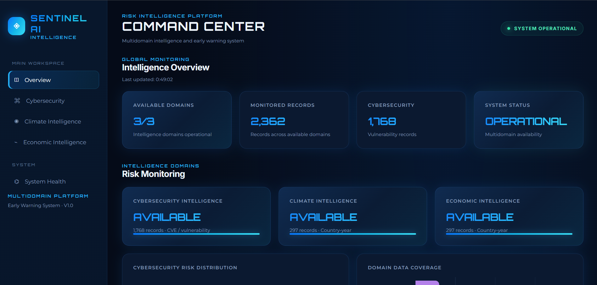

## Objetivos

- Recopilar datos de fuentes públicas y fiables.
- Limpiar, validar y transformar conjuntos de datos.
- Extraer características para el análisis.
- Detectar anomalías y señales emergentes de riesgo.
- Aplicar técnicas de Machine Learning y Procesamiento del Lenguaje Natural (NLP).
- Desarrollar motores de evaluación de riesgos específicos para cada dominio.
- Integrar información de inteligencia multidominio.
- Proporcionar información estructurada mediante una API REST.

## Dominios de riesgo

### Ciberseguridad

- Inteligencia sobre vulnerabilidades de CISA KEV y NVD.
- Ingeniería de características de vulnerabilidades.
- Experimentos de aprendizaje Positive-Unlabeled.
- Detección de anomalías mediante Isolation Forest.
- Evaluación explicable del riesgo en ciberseguridad.

 

  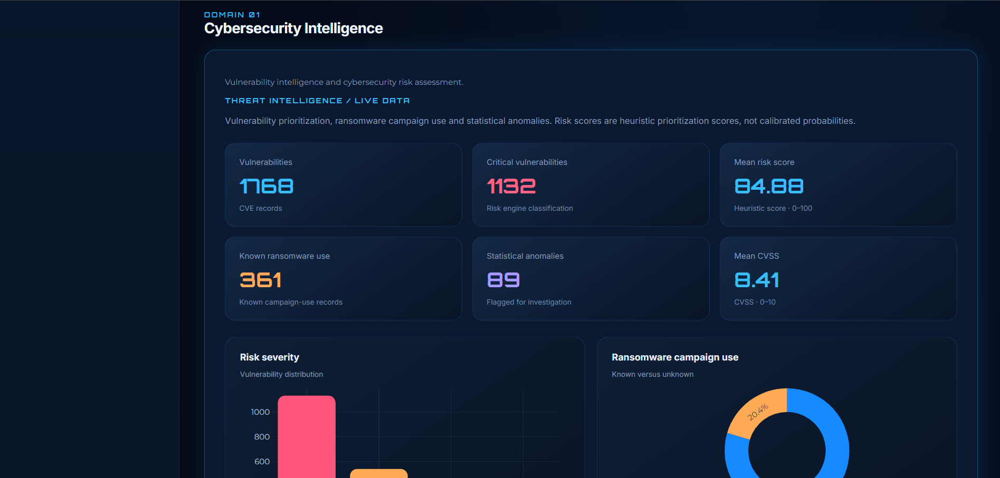
  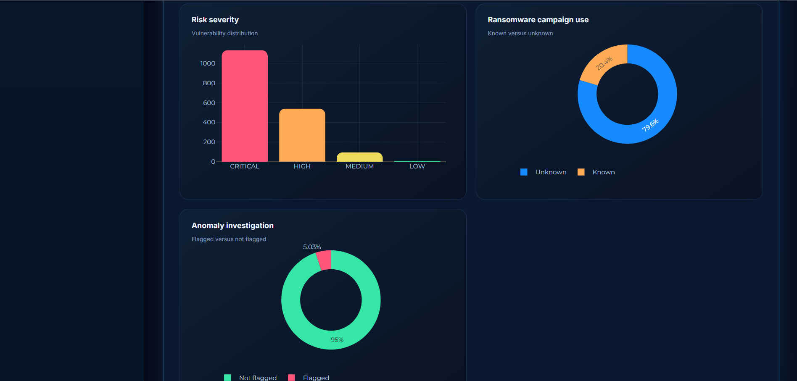
  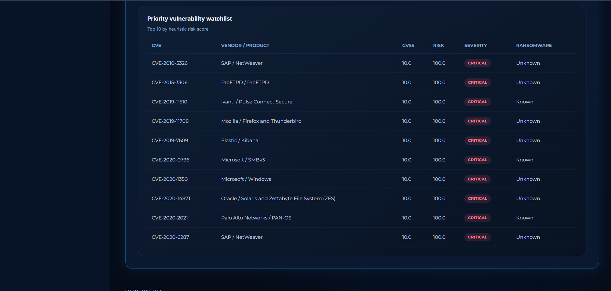

### Clima

- Procesamiento de datos climáticos europeos.
- Evaluación de exposición por país y año.
- Índice de Exposición Climática (Climate Exposure Index).

 

  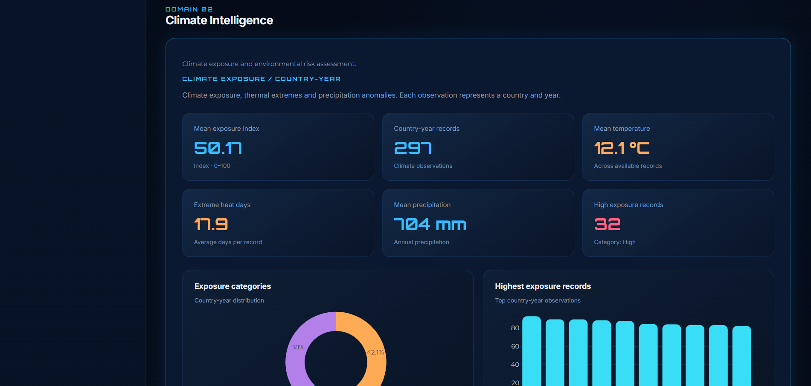
  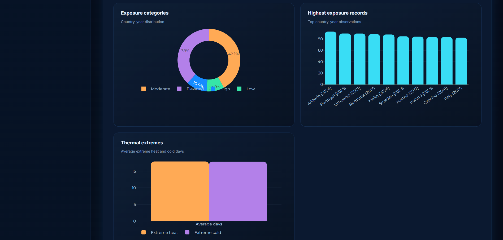
  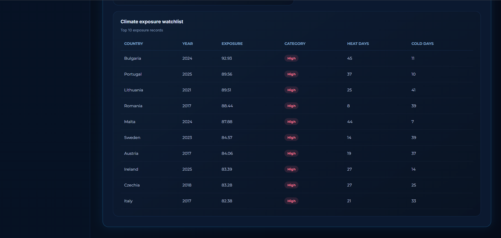

### Economía

- Procesamiento de indicadores económicos europeos.
- Evaluación del riesgo económico por país y año.
- Motor de Riesgo Económico y clasificación de riesgos.

 

  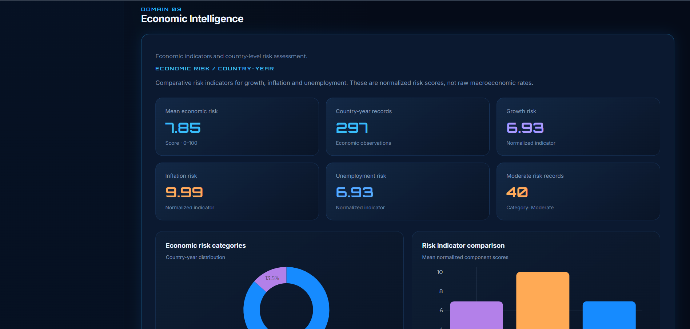
  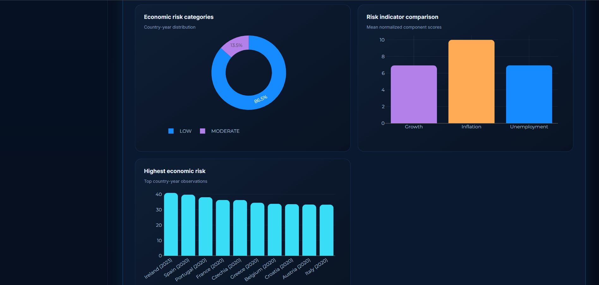
  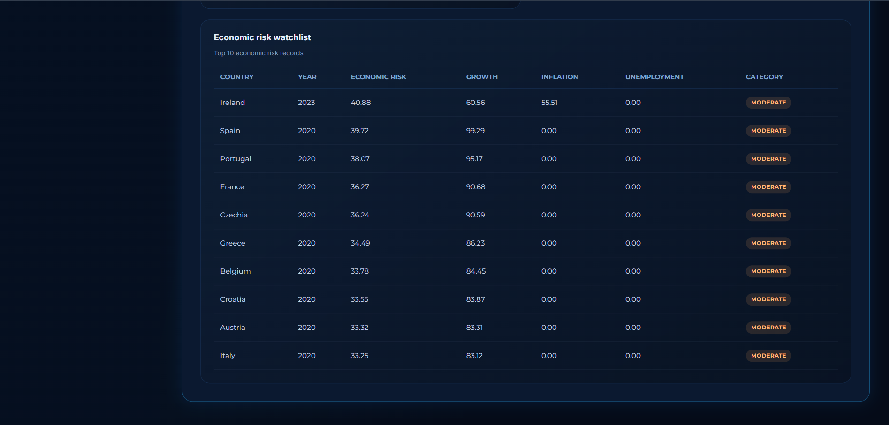

## Monitorización y estado del sistema

Sentinel AI incorpora un panel de monitorización que permite consultar el estado operativo de la plataforma y la disponibilidad de los servicios de cada dominio.

Entre la información mostrada se incluye:

- Estado general de la API REST.
- Disponibilidad de los tres dominios.
- Número de registros monitorizados.
- Estado individual de los servicios de ciberseguridad, clima y economía.
- Fecha y hora de la última comprobación.

  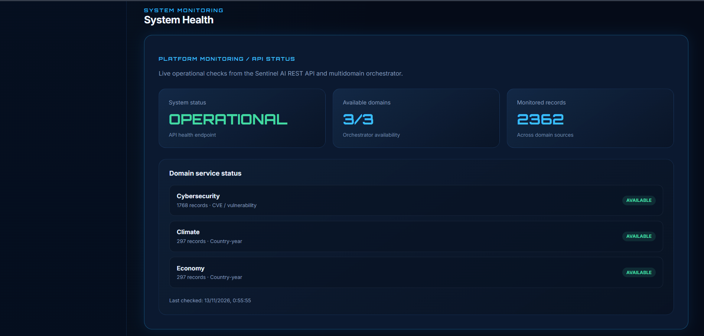

## Arquitectura multidominio

La capa de orquestación integra la inteligencia de ciberseguridad, clima y economía, manteniendo las unidades de análisis originales de cada dominio.

No calcula una media global no justificada entre observaciones que utilizan unidades de medida incompatibles.

## API REST (Backend)

Desarrollada con FastAPI, Uvicorn y Pydantic.

**Endpoints disponibles:**

- `GET /`
- `GET /health`
- `GET /domains`
- `GET /domains/{domain}`
- `GET /docs`
- `GET /openapi.json`

**Funcionalidades adicionales:**

- Esquemas de respuesta y gestión de errores centralizados.
- Registro de solicitudes y rotación de archivos de registro.
- Sistema de caché local al proceso con una duración de 60 segundos.
- Comprobación de disponibilidad de los dominios y validación de datos.

## Tecnologías utilizadas

- Python 3.12
- NumPy, SciPy y Pandas
- scikit-learn y Joblib
- Matplotlib
- FastAPI, Uvicorn y Pydantic
- Pytest, HTTPX y HTTPX2
- Herramientas de Procesamiento del Lenguaje Natural (NLP)

## Ejecución local de la API

Ejecuta el archivo `run_sentinel_api.bat` desde el entorno del proyecto.

**Dirección local:**

`http://127.0.0.1:8000`

**Documentación interactiva de la API:**

`http://127.0.0.1:8000/docs`

## Pruebas

La última ejecución completa de la batería de pruebas de regresión registrada finalizó correctamente, con **29 pruebas superadas**.

## Documentación

La documentación técnica está disponible en el directorio `docs/` e incluye documentación sobre:

- API.
- Orquestación multidominio.
- Riesgo económico.
- Machine Learning.

## Estado del proyecto

El núcleo de inteligencia multidominio y la API REST local están implementados y probados.

Actualmente, la API está orientada al desarrollo local. La autenticación, HTTPS y las medidas de seguridad necesarias para un despliegue en producción quedan fuera del alcance de la versión actual.

## Aviso

Sentinel AI es un prototipo analítico y de alerta temprana. Sus resultados sirven como apoyo a la investigación y a la toma de decisiones, pero no sustituyen la evaluación de expertos ni las valoraciones oficiales de riesgo.